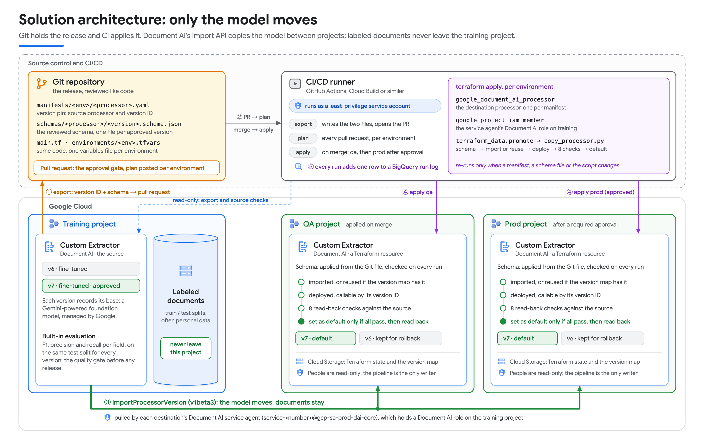

# GenDocAIOps: promote fine-tuned Document AI processor versions across projects

Reference implementation for the blog post *GenDocAIOps: Ship fine-tuned Document AI models like
software*. It promotes an approved Custom Extractor processor version from a training project to
qa and prod with Git, Terraform and Document AI's `ImportProcessorVersion` API. Every copy is checked
against its source before it becomes the default. Labeled documents never leave the training project.



## What's in this folder

Use the folder as the root of your own repository. The Terraform root module and the GitHub Actions
workflows run from it.

| Path | What it is |
|---|---|
| `main.tf`, `variables.tf`, `outputs.tf` | Terraform root module: one `google_document_ai_processor` per manifest, and a `terraform_data.promote` step that runs `scripts/copy_processor.py` when the pin, the schema file or the script changes |
| `manifests/<env>/<processor>.yaml` | the version pin: source processor, approved version ID, schema file ([example](manifests/example/invoice_extractor.yaml)) |
| `schemas/<processor>/<version>.schema.json` | the reviewed schema, one file per approved version |
| `environments/<env>.tfvars` | one file per environment: destination project, manifest folder, version map, run log ([README](environments/README.md)) |
| `scripts/export_processor.py` | writes the manifest and the schema file from the approved version; `--open-pr` opens the pull request |
| `scripts/copy_processor.py` | applies the schema, imports or reuses the version, deploys it, runs eight read-back checks, then sets the default |
| `scripts/compare_processors.py` | read-only side-by-side of two processors: versions, schema diff, evaluations, audit log; `--migration` prints the eight checks as PASS/FAIL |
| `.github/workflows/` | `plan.yml` (pull request), `apply.yml` (merge: qa, then prod), `export.yml` (export from the GitHub UI) |
| `bootstrap/setup_cicd.sh` | one-time setup per destination project: service account, state bucket, Workload Identity Federation for GitHub Actions, IAM grants, `environments/<env>.tfvars` |
| `tests/` | offline unit tests for the version map and the default switch |
| `docs/` | [CICD_SETUP.md](docs/CICD_SETUP.md), [IAM.md](docs/IAM.md) |

## How a promotion works

In Git and CI:

1. **Export** the approved version: the manifest and the schema file.
2. **Open a pull request.** It's the approval gate.
3. **Plan.** CI runs `terraform plan` for each environment and posts it on the pull request.
4. **Review** the schema diff and the version pin like code.
5. **Merge.** CI applies qa first, then prod.

Inside each apply, for each processor whose manifest, schema file or script changed:

1. Terraform **creates** the destination processor, or adopts an existing one.
2. **Pre-flight checks** confirm the permissions on both projects, including that the destination
   project's Document AI service agent can read the training project.
3. The **schema** from the Git file is applied to the processor.
4. The approved version is **imported** with `ImportProcessorVersion`, or **reused** if the version
   map shows it's already there.
5. The version is **deployed**, but not yet made the default.
6. The copy is **verified**: eight read-back checks against the source (processor type, dataset
   schema, source version, deployed, version name, not Google's pretrained model, same base model,
   the version's own schema).
7. Only if every check passes does the copy become the **default**, and the run reads the processor
   back to confirm the switch. A failed check exits with code 3, fails the apply and leaves the
   current default in place.

## Before you start

- A training project with a fine-tuned Custom Extractor version that has been evaluated and approved.
- One destination project per environment, for example qa and prod, with **billing enabled**. The
  import works without billing; the deploy fails with `BILLING_DISABLED`.
- The Document AI, Cloud Storage and Cloud Resource Manager APIs enabled, and BigQuery where the run
  log lives. `bootstrap/setup_cicd.sh` enables them in the destination projects.
- The destination project's Document AI service agent,
  `service-<destination project number>@gcp-sa-prod-dai-core.iam.gserviceaccount.com`, with
  `roles/documentai.editor` on the training project. The import runs as this identity.
- Terraform 1.7 or later, Python 3.10 or later, and the Google Cloud CLI.

All identities and roles: [docs/IAM.md](docs/IAM.md).

## Quickstart: one promotion from your workstation

This uses your own credentials (Application Default Credentials). No CI setup is needed.

```bash
gcloud auth application-default login
python3 -m venv .venv
.venv/bin/pip install -r scripts/requirements.txt
```

**1. Export the approved version.** This writes `manifests/qa/invoice_extractor.yaml` and
`schemas/invoice_extractor/<version name>.schema.json`. Review both: they're the release.

```bash
.venv/bin/python scripts/export_processor.py \
  --source-processor projects/my-training-project/locations/us/processors/<processor-id> \
  --processor-key invoice_extractor --env qa \
  --version-id <approved-version-id> --dest-display-name invoice-extractor-qa
```

Already have a destination processor? Adopt it instead of creating a second one: set
`existing_processor_id: "<id>"` in the manifest. After the first successful apply, delete the line.

**2. Describe the environment.** Copy the example and set the destination project and the version
map location.

```bash
cp environments/example.tfvars environments/qa.tfvars
```

**3. Choose where the state lives, then plan and apply.**

```bash
cp backend_override.tf.example backend_override.tf
terraform init -backend-config="bucket=my-qa-project-tfstate" -backend-config="prefix=qa"
terraform plan  -var-file=environments/qa.tfvars -var python_bin=.venv/bin/python
terraform apply -var-file=environments/qa.tfvars -var python_bin=.venv/bin/python
```

For a throwaway run with local state, change the block in `backend_override.tf` to
`backend "local" {}`.

An import plus deploy takes roughly 5 to 15 minutes per processor; a reuse takes about one. A second
`terraform plan` then says "No changes".

## Promotion through GitHub Actions

Run the setup script once per destination project, then promote through pull requests:

```bash
./bootstrap/setup_cicd.sh --project my-qa-project   --github <owner>/<repo> --env qa   --source my-training-project
./bootstrap/setup_cicd.sh --project my-prod-project --github <owner>/<repo> --env prod --source my-training-project
```

The workflows authenticate with Workload Identity Federation, so there are no service account keys.
Details, including how to require an approval before prod: [docs/CICD_SETUP.md](docs/CICD_SETUP.md).

## Version map, rollback and the run log

`ImportProcessorVersion` gives the copy a new ID and keeps only its display name, which isn't
unique. So `copy_processor.py` keeps a small JSON file per destination processor, the **version map**
(`version_map_uri`, for example `gs://<project>-tfstate/<env>/version_map`):

| Situation | Behavior |
|---|---|
| source version already mapped, destination version alive | reuse, no import |
| not mapped, no version with the same name in the destination | import, record |
| not mapped, a same-name version exists and no other source claims it | adopt once, record, warn |
| not mapped, the same-name version belongs to another source version | import anyway, both coexist, warn |
| mapped version deleted or FAILED | forget, import again |

**Rollback is `git revert`.** Reverting the merge that promoted v7 puts the manifest back on v6. The
version map shows v6 is still in the destination, so nothing is imported: v6 passes the same checks
and the default switches back in about a minute. Keep the previous version deployed and rollback
stays that fast.

**The run log** is one BigQuery row per run, in
`<training project>.docai_migration_logs.migration_events` by default: what was promoted where, when,
the version action (`imported`, `reused`, `adopted`) and the result. The dataset and table are created
if they're missing. Set `bigquery_dataset_id = ""` to turn it off.

```sql
SELECT
  FORMAT_TIMESTAMP('%m-%d %H:%M', execution_timestamp) AS at_utc,
  destination_project_id                              AS project,
  destination_processor_name                          AS processor,
  version_action,
  source_version_id,
  destination_version_id,
  destination_processor_id,
  execution_status,
  dataset_copied
FROM `PROJECT.docai_migration_logs.migration_events`
ORDER BY execution_timestamp DESC
LIMIT 15;
```

`copy_processor.py` exit codes: `0` success, `1` error, `2` pre-flight failure or bad arguments,
`3` a check failed (the default is unchanged).

## Compare two processors

`compare_processors.py` is read-only. Run it before a release, or to check a copy afterwards:

```bash
# the eight checks, as PASS/FAIL: source processor in training vs the copy in qa
.venv/bin/python scripts/compare_processors.py my-training-project/<source-processor-id> \
  my-qa-project/<qa-processor-id> --migration --version-a <source-version-id>

# send the same approved test documents to both versions (one pass) and compare the extracted fields
.venv/bin/python scripts/compare_processors.py my-training-project/<id> my-qa-project/<id> \
  --migration --version-a <source-version-id> --version-b <qa-version-id> \
  --probe gs://my-bucket/approved-test-documents/
```

Run `--help` for all options. If it fails with `CERTIFICATE_VERIFY_FAILED` on macOS, point Python at
a CA bundle: `export SSL_CERT_FILE=$(.venv/bin/python -m certifi)`.

## Tests

```bash
.venv/bin/python tests/test_version_map.py
.venv/bin/python tests/test_default_switch.py
```

Both run offline, with no Google Cloud calls and no credentials.

## Good to know

- **Processors are protected.** `prevent_destroy` is on for the processor resource. Changing a
  manifest's `display_name` or `processor_type`, or deleting a manifest, would destroy the processor
  and its versions, so the plan fails instead. Set it to `false` only for throwaway environments.
- **Air-gapped environments.** The import is pulled by the destination project, so its service agent
  needs access to the training project. Where nothing in production may reach development, move the
  labeled documents, fine-tune again, and compare evaluation results instead.
- **Why a Python step.** At the time of writing, the Terraform provider has no resources for processor
  versions or schemas, and `ImportProcessorVersion` is in the `v1beta3` API.
- **More script options.** `copy_processor.py --snapshot-to-gcs` takes a restorable snapshot of a
  processor's dataset schema and documents, and `--restore-from-gcs` restores it. `--copy-dataset`
  copies the labeled documents too; it's off by default, and this pattern doesn't need it.

## Disclaimer

This is not an officially supported Google product. This code is provided on an "as-is" basis,
without warranties or conditions of any kind.
